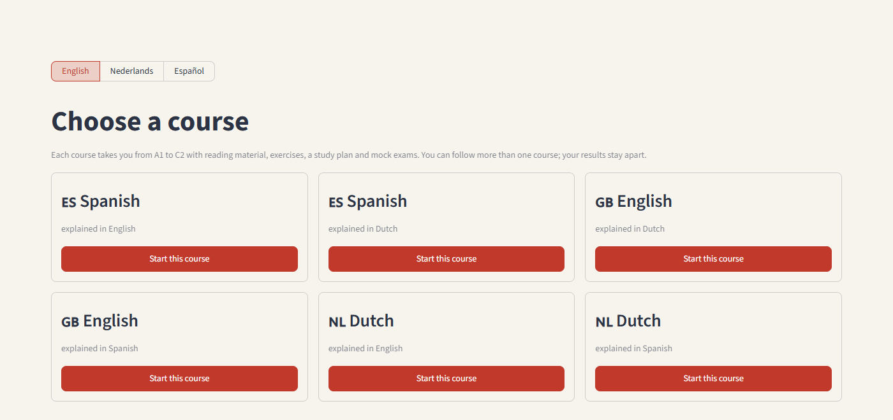
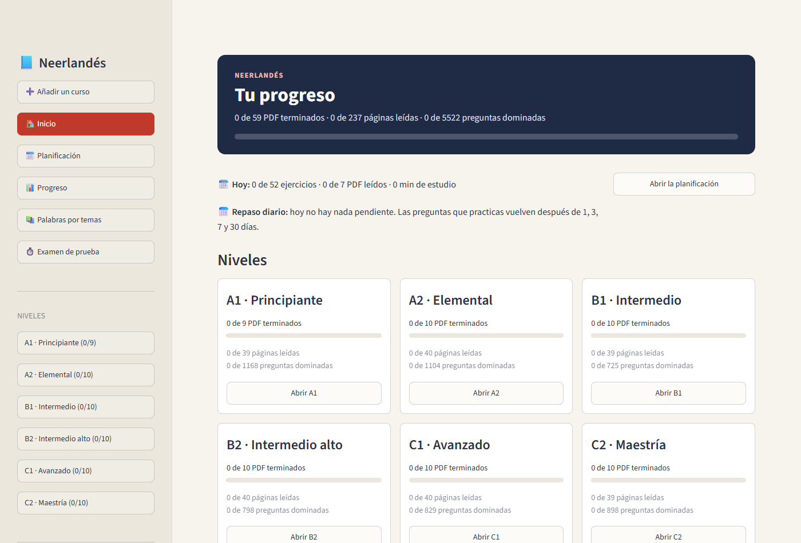
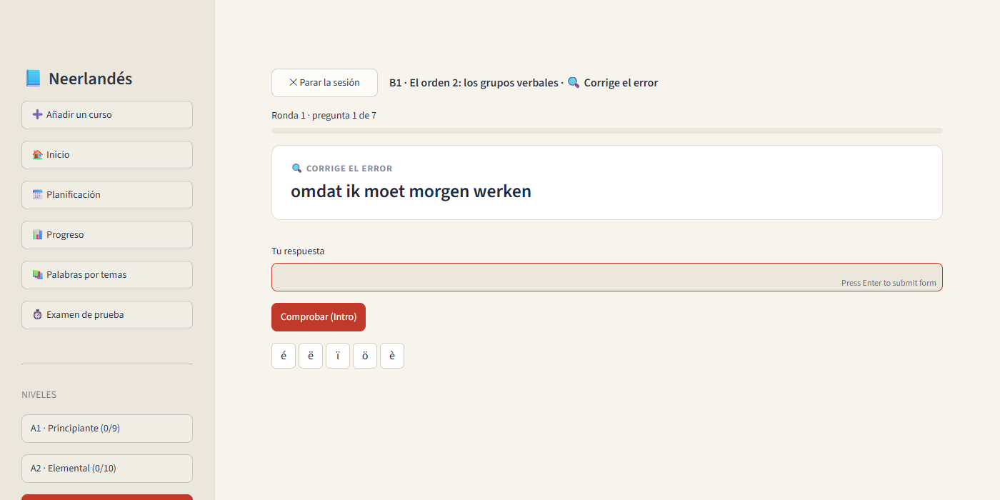

# Language Learning

A study website for Spanish, English and Dutch, from beginner level up to C2. Each course
combines 59 study PDFs with a reader, thousands of practice questions, a daily study plan up to your
own deadlines, and progress tracking.

Built with Python and [Streamlit](https://streamlit.io) as my first GitHub project, while learning
Python. The study material was written by me together with Claude.



## The six courses

Each language is taught in the variety of one country, and explained in another language. The
whole site (buttons, messages, help) is in the language that explains the course.

| Course | Explained in | Variety | Exam it prepares for | Practice questions | Word list entries |
|---|---|---|---|---|---|
| 🇪🇸 Spanish | English | Spain | DELE | 9,354 | 2,367 |
| 🇪🇸 Spanish | Dutch | Spain | DELE | 9,352 | 2,411 |
| 🇬🇧 English | Dutch | British | Cambridge (A2 Key to C2 Proficiency) | 5,259 | 510 |
| 🇬🇧 English | Spanish | British | Cambridge (A2 Key to C2 Proficiency) | 5,257 | 514 |
| 🇳🇱 Dutch | English | the Netherlands | Inburgering, Staatsexamen NT2, CNaVT | 5,512 | 512 |
| 🇳🇱 Dutch | Spanish | the Netherlands | Inburgering, Staatsexamen NT2, CNaVT | 5,522 | 512 |

A course is not a word-for-word translation of another one. The explanations, the typical mistakes
and the word lists are written for the people who speak the explaining language: Dutch speakers
learning English get "eventually is not eventueel", Spanish speakers learning Dutch get "genant is
not embarazada", and each course has its own list of traps for its speakers.

You can follow more than one course. Your results are kept apart per course, and the sidebar
switches between them.



## What it does

**Read:** 59 PDFs per course across levels A1 to C2, sharp at any zoom, with the arrow keys to turn
pages. The app remembers where you stopped.

**Practise:** every PDF has its own practice session, with these exercise types where the PDF has
the material for them. After each session a short summary follows, and Enter starts the next type,
from recognising words to producing whole sentences. After the last type, Enter opens the next PDF.

| Exercise | What you do |
|---|---|
| 🔄 Words, to your language | See the word in the language you learn, type it in your own |
| ⚖️ el or la? / de or het? | Choose the article of a noun, with two keys (Spanish and Dutch) |
| 🔤 Words, from your language | See the word in your own language, type it in the one you learn |
| 🔁 Verb forms | Type the form for a given verb, person and tense |
| 📝 Grammar exercises | Type the missing part of a sentence; in the PDFs about verbs also sentences in which the context tells you which form you need |
| 🧩 Build the sentence | Click the words in the right order |
| 🎧 Listening | Hear a sentence, type what you hear |
| 🔍 Fix the mistake | Correct a wrong sentence and see why it was wrong |
| 💬 Translate sentences | Type the whole sentence in the language you learn |
| 🎯 Mixed test | All of the above mixed together, started by hand |

A session has all questions of a type, or 10 or 20 if you are short of time. Each exercise and
each word list has a "Mark as done" checkbox for exercises you have finished elsewhere or don't
need.



**Remember it:**

- **Rounds:** you see everything once, then only what you got wrong until all of it is correct.
- **Daily review:** questions come back after 1, 3, 7 and 30 days, and a wrong answer brings a
  question back the next day.
- **Mastered:** a question counts as mastered when your last first try at it was right.
- **Weak questions and weak subjects:** what you often get wrong is chosen more often and can be
  practised separately, and the home and level screens list the PDFs and word lists where less
  than 70% was right on the first try.
- **Skip what I know:** a switch that leaves out the questions you already mastered.

**Plan it:** the 🗓️ Schedule screen turns everything into a daily list of PDFs to read and
exercises to finish, up to your own deadlines (for example A1 to B2 by December and C1 and C2 by
January). Every morning the plan starts again from where you are, so working ahead makes the
coming days lighter. It shows today's list, the coming days, what is left per deadline with your
expected finish date, a calendar, and the official mock exams: two per level, with a link to the
official practice papers and your score for each part.

**Look back:** the 📊 Progress screen shows your study time, exercises, questions and first-try
accuracy week by week, trends over time, and your progress per level. The app times your study
from your answers and page turns, and you can add time you studied elsewhere.

**Word lists:** themed lists of 12 to 30 words or phrases with a level each, about subjects such as
food, travel, work and health, and lists of useful language (connectors, phrasal verbs or
separable verbs, false friends, the traps for your own language). Most language lists come with an
example sentence to complete.

**Mock exam:** a timed mix of exercises from one level. It trains exam pressure, but it does not
follow the format of the official exams; for those, the Schedule links to the official papers.

### How answers are graded

| What differs from the correct answer | Result |
|---|---|
| Capital letters, dots and similar punctuation | 🟢 Ignored |
| ? and ! (and ¿ ¡ in Spanish) | 🟡 Warning, still counts as correct |
| Missing accent, outside verb forms (and ñ typed as n) | 🟡 Warning, still counts as correct |
| Missing article in vocabulary (el / la, de / het) | 🟡 Warning that names the article |
| American spelling in the English courses (color) | 🟡 Warning that names the British spelling |
| Short and long forms in English (don't, do not) | 🟢 Both correct |
| Subject pronoun added or left out in Spanish (yo hablo, hablo) | 🟢 Ignored |
| Missing accent in a Spanish verb form (hablo, habló) | 🔴 Wrong |

In "Fix the mistake" the exact mistake has to be corrected, and in the PDFs about accents, accents
have to be right. A language often allows several correct sentences, so a wrong answer has an
"I was actually right" button: your answer then counts as correct from then on, everywhere the
same question comes back.

## Run it on your own computer

Windows only. You need [Python 3.11 or newer](https://www.python.org/downloads/); tick "Add python.exe
to PATH" while installing.

1. Download this project and open its folder.
2. Double-click `start.bat`. The first run installs the packages, which takes about a minute.
3. Your browser opens at http://localhost:8501. Choose a course.

Everything runs on your own computer. Listening needs a voice for the language you learn in your
browser (Spanish (Spain), English (United Kingdom) or Dutch (Netherlands)), which Edge and Chrome
normally have. If the app warns that it is missing, go to Windows Settings, Time & language,
Speech, Manage voices, Add voices, and restart your browser.

Your results are saved in the `results` folder, one set of files per course (for example
`es_from_en_practice.json`). Git leaves this folder out on purpose, so back it up yourself, or use
**💾 Your data** in the sidebar to download a backup of the open course.

### Online

The app can also run as a website, so people without Python can use it on any computer, Mac
included. Each person logs in and has their own results, saved in a free online database. People
you send an invite code to can make their own account. [DEPLOY.md](DEPLOY.md) explains how to set
it up.

## How the code is organised

| File | What it does |
|---|---|
| `app.py` | Home screen, level screens, the PDF reader and the backups |
| `courses_screen.py` | Choosing a course and switching between your courses |
| `course.py` | Which course is open, and where its files and results are |
| `languages.py` | What is different per language: accents, articles, pronouns, voices |
| `ui_text.py`, `ui_text/` | The screens in English, Dutch and Spanish |
| `practice_items.py` | Turns the PDF source data into questions |
| `practice_logic.py` | Checks answers, runs the rounds, chooses the questions |
| `practice_store.py` | Saves results and schedules the daily review |
| `practice_screen.py` | The practice screens |
| `extra_screens.py` | The themed word lists and the mock exam |
| `schedule_screen.py`, `study_plan.py` | The Schedule screen and the daily lists |
| `progress_screen.py` | The Progress screen |
| `study_log.py` | Study time per day, finished dates, daily lists and mock exam scores |
| `storage.py` | Saves results: in files on your own computer, or in the online database |
| `login.py`, `accounts.py` | The login of the online version, accounts and the admin part |
| `clock.py` | Today's date in each person's own time zone |
| `make_pdfs.py` | Makes the PDFs from the source data |
| `build_catalog.py` | Rebuilds a course's `catalog.json`, after changing its PDFs |
| `content_sheet.py` | Lists the texts of a unit to translate it into a new course, and writes the result |
| `courses/<course>/` | Per course: `course.json` (languages, exam), `content/` (the source data of each PDF, with the exercises), `themes/` (word lists), `verbs_in_context/` |
| `static/<course>/` | The PDFs |
| `run_tests.py` | Runs all tests: content, practice, schedule, interface texts and PDFs |

To check that everything still works after a change (this takes about ten minutes):

```
.venv\Scripts\python.exe run_tests.py
```
